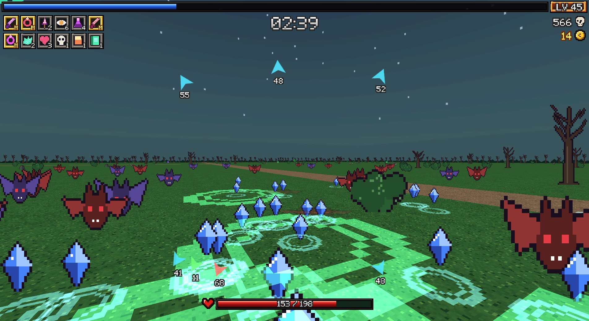
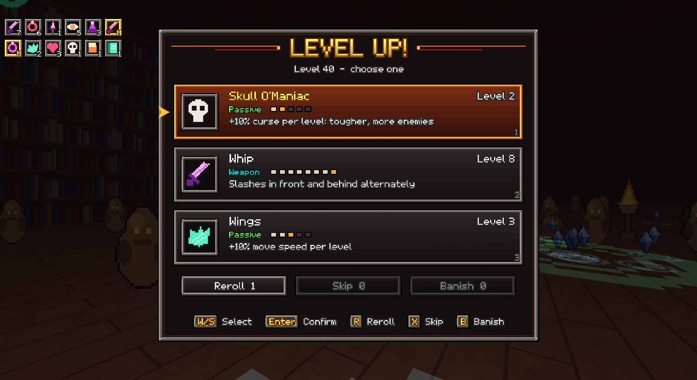
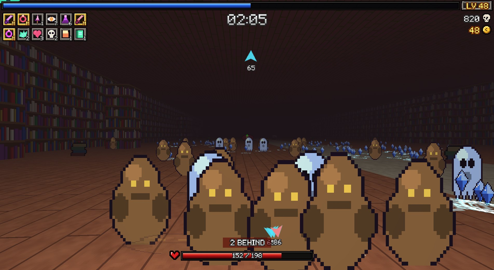
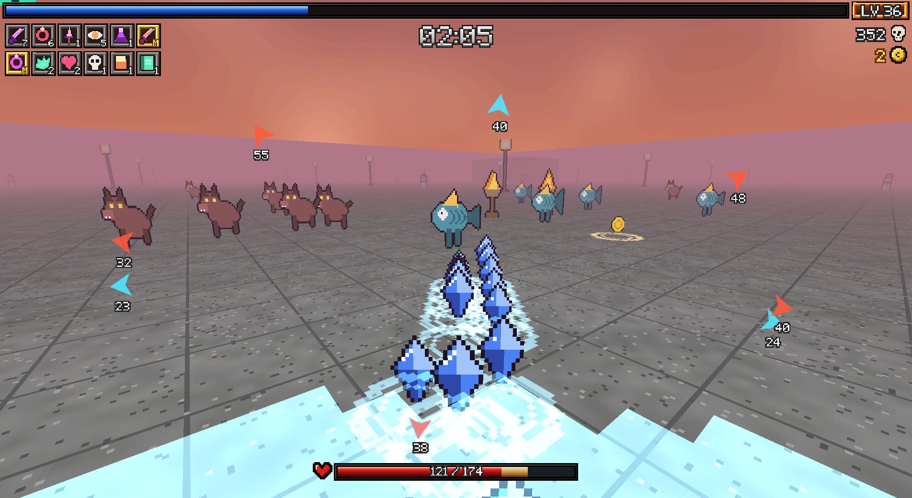
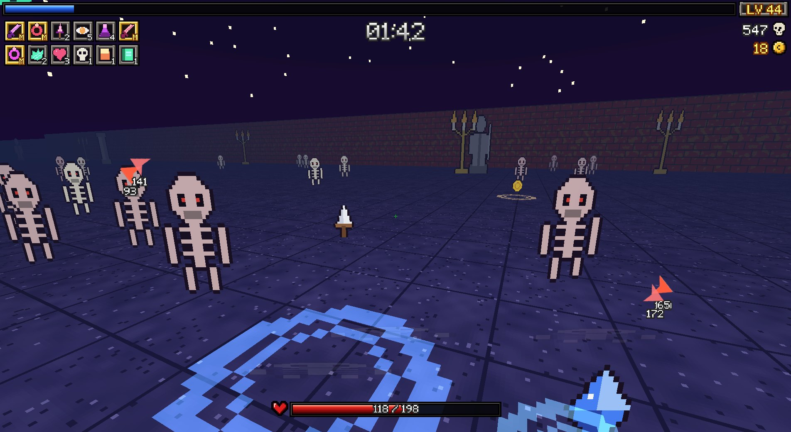
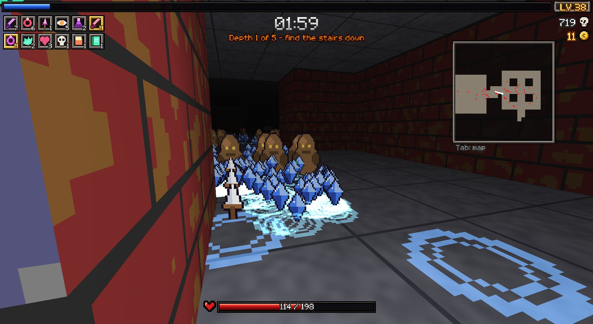
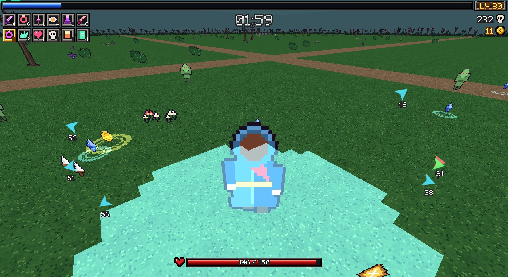

# Doom Survivors

**A first-person survivors-like.** Hordes close in from every side, your weapons fire on their
own, and every level-up makes you stronger, all seen from inside the crowd instead of from
above. It's a fan-made reimagining of *Vampire Survivors* built on the
[UZDoom](https://github.com/UZDoom/UZDoom) engine.



## Download and play (Windows)

1. Download **`DoomSurvivors-<version>-win64.zip`** from the [latest release](https://github.com/harminoff/doom-survivors/releases/latest).
2. Extract the whole zip anywhere.
3. Double-click **`DoomSurvivors.exe`**.

You don't need to install anything, and you don't need Doom: the engine is bundled. Your
settings and progress are saved in the `userdata` folder next to the exe, so the game folder
is portable.

If you already have UZDoom 5.x, the release also includes the game as a single file,
**`doom-survivors-<version>.ipk3`**. Run it with `uzdoom -iwad doom-survivors-<version>.ipk3`.

**Controls:** WASD to move, mouse to look, **C** to switch first / third person, **Esc** for
the menu. Weapons attack automatically; you choose upgrades when you level up.

## What's in it

- **25 stages**, from Mad Forest, Inlaid Library, Dairy Plant and Gallo Tower to Moongolow,
  Bat Country and Space 54, each with its own enemy waves, bosses and the Reaper at the end.
- **The Depths**, a roguelike dungeon stage: a new floor plan every run, rooms joined by
  real stairs, spike pits, treasure rooms and a minimap. Fetch the Amulet from the bottom
  floor and climb back out.
- **26 characters** and **77 weapons and evolutions**. Every equipped weapon fires on its own
  and at the same time as the others, including evolutions, unions and the stranger
  late-game weapons.
- Passives, chests, Arcana, gold, a merchant, stage items and gimmicks, meta progression and
  unlocks.
- **A first-person or third-person view**, with optional aim assist for facing-aimed weapons.
- **All-original audio**: 174 sound effects (a distinct sound for nearly every weapon,
  enemy family, pickup and event) and 12 music tracks, a theme for each main stage. All of
  it was generated locally with Stable Audio 3 and mixed so big fights stay readable.

| | |
|---|---|
|  |  |
|  |  |
|  |  |

## Building from source

You need Windows and Python 3.11. The build itself uses only the Python standard library.

```
python tools/bootstrap/bootstrap.py        # fetches and verifies the pinned UZDoom 5.0.1 runtime
python tools/build.py --stages             # builds build/doom-survivors.ipk3
powershell -File "Launch Doom Survivors.ps1"   # builds and plays
python tools/release/make_release.py 0.1.0 # the Windows zip and the .ipk3, in dist/
python -m pytest -q                        # tests
```

How the source is organised:
- `src/zscript/` is the game, in ZScript.
- `src/resources/` holds the engine lumps, art, sounds and music.
- `maps/source/` holds the stage layouts that `tools/build.py` turns into maps.
- `tools/audio/` is the sound and music pipeline. It's optional, and needs a separate
  Stable Audio 3 environment. See `tools/audio/sa3_generate.py`.

## Credits and notes

- This is a **fan project**. It isn't affiliated with or endorsed by poncle, the makers of
  *Vampire Survivors*, and it contains none of that game's art, audio or files. Names and
  gameplay values follow the community [Vampire Survivors Wiki](https://vampire.survivors.wiki/)
  and are approximations. Doom is a trademark of id Software; this isn't a Doom mod and
  needs no Doom data.
- The engine is **UZDoom** ([GPL-3.0](https://github.com/UZDoom/UZDoom)). The release bundles
  UZDoom 5.0.1 unmodified, with its license texts (`engine/licenses.zip`) and a pointer to
  its source (`THIRD_PARTY.txt`).
- The art was made for this project with generation tools and scripts (`tools/art/`), and
  the audio with Stable Audio 3 (`tools/audio/`).
